<!-- Hero Section: Animated terminal aesthetic -->
<h3><code>aaditya079@github ~ $ ./contributions.sh</code></h3>

  

<h3><code>aaditya079@github ~ $ whoami</code></h3>

<table border="0" cellpadding="0" cellspacing="0">
  <tr>
    <td valign="top" style="border: none; padding: 0;"></td>
    <td valign="top" style="border: none; padding: 0; padding-left: 10px;"></td>
  </tr>
</table>

## 🚀 About Me

My name is **Aaditya Srinivasan K S**, an AI & Data Science engineer and systems developer. I build intelligent multi-agent workspaces, high-performance native desktop applications, and responsive, data-driven interfaces.

<ul>
  <li>🎓 <b>B.Tech Student</b> in Artificial Intelligence & Data Science at SRM MDU</li>
  <li>🧠 <b>Core Focus:</b> Multi-Agent LLM Orchestration, Autonomous Workflows & Systems Architecture</li>
  <li>⚡ <b>Currently Building:</b> <a href="https://github.com/aaditya079/NEURALIS"><b>NEURALIS</b></a> (browser-native multi-agent dev console) & <a href="https://github.com/aaditya079/BitChord-PC"><b>BitChord-PC</b></a> (native Rust audio engine)</li>
  <li>🎯 <b>Goal:</b> Engineer resilient, lightweight systems bridging autonomous AI models with polished native UIs</li>
</ul>

## ⭐ Featured Flagship

<table border="1" cellpadding="12" cellspacing="0" width="100%" style="border-color: #30363d; border-radius: 8px; border-style: solid; border-collapse: collapse; background-color: #0d1117;">
  <tr>
    <td>
      <h3 align="center">🌐 <b>NEURALIS // Multi-Agent Developer Console</b></h3>
      
<i>Interactive browser-native workspace for orchestrating and executing multi-agent AI workflows</i>

      
A high-performance dev console designed to coordinate autonomous AI agents, stream real-time execution steps, and generate software pipelines using local Ollama or cloud LLMs.

      <ul>
        <li>🤖 <b>Multi-Agent Swarm Orchestration:</b> Coordinate specialized agents for coding, architecture review, and security verification.</li>
        <li>🔌 <b>Hybrid Model Engine:</b> First-class support for local privacy-focused Ollama models alongside cloud providers.</li>
        <li>⚡ <b>Zero-Friction Dev Console:</b> Live reactive UI with tool execution telemetry and artifact visualizers.</li>
      </ul>
      

        
        
      

    </td>
  </tr>
</table>

 

### 📦 Key Projects

<table border="0" cellpadding="8" cellspacing="0" width="100%">
  <tr>
    <td width="50%" valign="top">
      <h4>🦀 <a href="https://github.com/aaditya079/BitChord-PC">BitChord PC</a></h4>
      
Blazing-fast native YouTube Music desktop client engineered in <b>Rust</b> and <b>egui</b> with rodio audio. Zero Electron, zero webview bloat, lightweight memory footprint.

    </td>
    <td width="50%" valign="top">
      <h4>🧸 <a href="https://github.com/aaditya079/Desktop-Companion">Desktop Companion</a></h4>
      
Interactive borderless desktop companion built with <b>Godot 4</b> and Live2D Cubism (<code>gd_cubism</code>), featuring transparent viewport rendering and model interactions.

    </td>
  </tr>
  <tr>
    <td width="50%" valign="top">
      <h4>🔍 <a href="https://github.com/aaditya079/ImgSeek">ImgSeek</a></h4>
      
High-performance Windows utility powered by native <code>Windows.Media.Ocr</code> for instant offline search across image libraries and screenshots.

    </td>
    <td width="50%" valign="top">
      <h4>🏫 <a href="https://github.com/aaditya079/Vibecraft">Vibecraft</a></h4>
      
Smart attendance margin simulator and timetable room finder tailored for student workflow and campus scheduling. Deployed on Vercel.

    </td>
  </tr>
</table>

## 🛠️ Tech Stack & Arsenal

<table border="0" cellpadding="0" cellspacing="0" width="100%">
  <tr>
    <td valign="top" width="33%">
      <h3>💻 Languages</h3>
      

         
         
         
         
         
         
        
      

    </td>
    <td valign="top" width="33%">
      <h3>⚙️ Frameworks & Engines</h3>
      

         
         
         
         
         
         
        
      

    </td>
    <td valign="top" width="34%">
      <h3>🗄️ Infrastructure & Tools</h3>
      

         
         
         
         
         
         
        
      

    </td>
  </tr>
</table>

## 📊 Contribution Activity

The live contribution heatmap at the top of this profile is synced automatically using GitHub Actions.

## 🔗 Connect With Me

  
  &nbsp;
  

  <h3>✨ <i>"Reze ma Queen 🥀"</i></h3>

